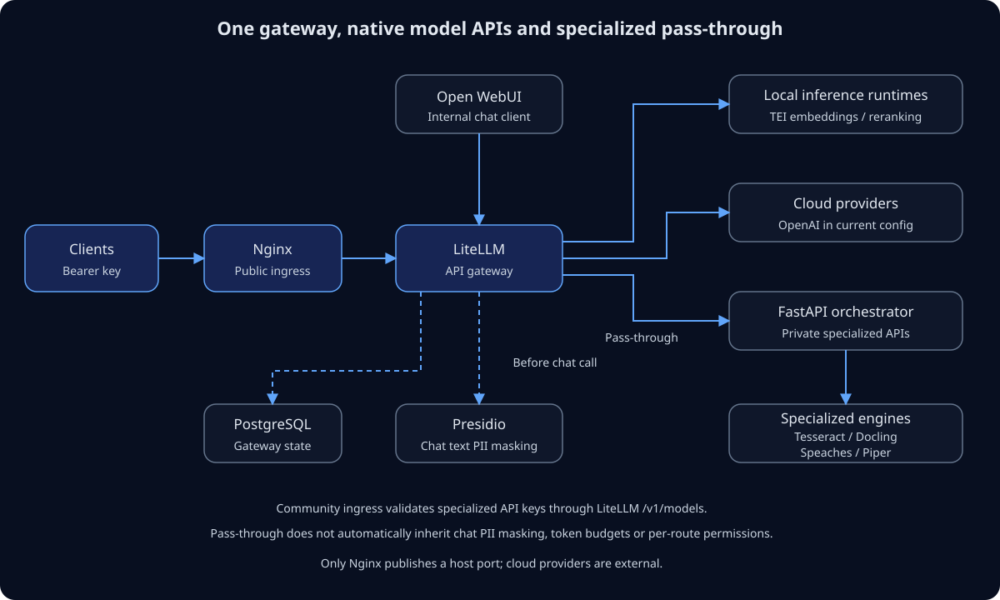

# AIFactoryBox

A self-hosted gateway built around LiteLLM Proxy. Model APIs reach local
inference runtimes or cloud providers; specialized document, audio, OCR and
standalone privacy APIs pass through LiteLLM to a small internal FastAPI service.

[Open diagram at full size](docs/assets/gateway-architecture.svg).

Nginx is the public ingress. For Community pass-through routes it validates
bearer keys through LiteLLM before forwarding requests. This is key validation,
not automatic PII protection, fine-grained permissions or token budgeting for
specialized operations. Read the [security boundaries](docs/security.md).

## Start here

- [Quickstart](docs/quickstart.md): configure credentials, start Compose, create a key and check services.
- [Architecture](docs/architecture.md): request paths, component responsibilities and runtime/model distinction.
- [API guide](docs/apis.md): authenticated examples and contract changes.
- [Model inventory](docs/models.md): current defaults, language tradeoffs and proposed profiles.
- [Development and validation](docs/development.md): local setup, tests and what has actually been verified.

The current Compose stack includes PostgreSQL, Open WebUI and specialized engines.
It is not the proposed two-container LiteLLM + Ollama profile. No Ollama/Gemma
profile or model-management console is implemented yet.

The static `website/` page describes the project. The Compose gateway serves
Open WebUI at `/`; neither the static site nor the Vercel adapter deploys the
complete gateway.
