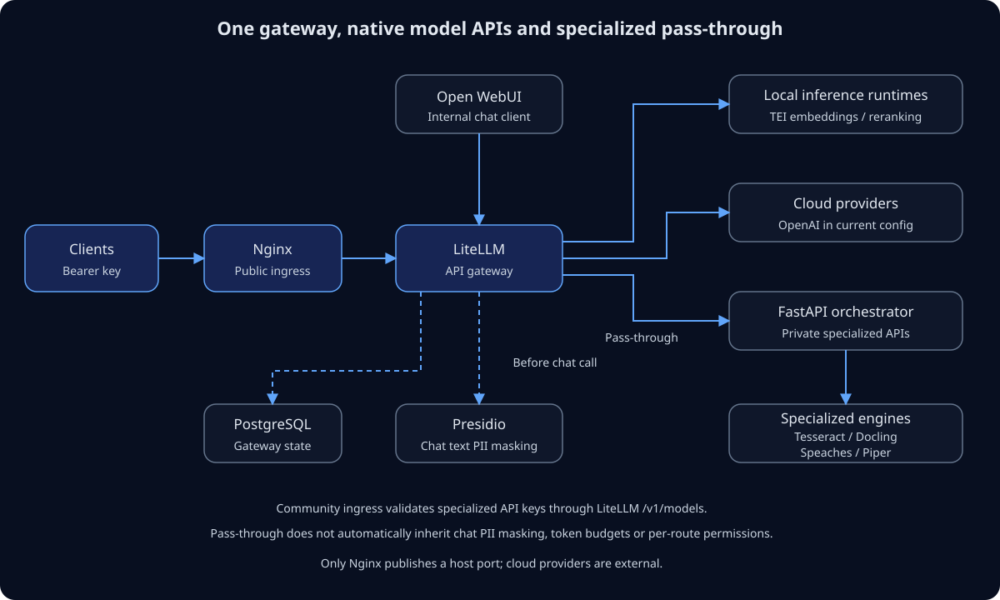

# Gateway architecture

[Open diagram at full size](assets/gateway-architecture.svg).

## Request paths

**Model requests:** clients use Nginx → LiteLLM → a supported local runtime or
cloud provider. Open WebUI calls LiteLLM on the internal Compose network.
LiteLLM owns `/v1/chat/completions`, `/v1/embeddings`, `/v1/models` and the native
rerank endpoints. Before a supported chat text request reaches its model,
LiteLLM invokes the configured Presidio pre-call guardrail.

**Specialized requests:** clients use Nginx → LiteLLM pass-through → FastAPI →
the specialized engine. Existing document, standalone privacy, audio and OCR
paths are registered explicitly; there is no wildcard user-selected upstream.
FastAPI runs Tesseract locally and calls the other services over HTTP.

In the pinned LiteLLM Community version, native pass-through authentication
requires Enterprise. Nginx therefore makes an internal GET `/v1/models`
subrequest to LiteLLM to validate the bearer key before forwarding a specialized
request. Rejected or missing keys cannot reach the pass-through. Internal routes
use `auth: false`; **neither LiteLLM nor FastAPI may be published directly**.

This check does not enforce specialized-route permissions, model token budgets
or per-user pass-through accounting. Any key accepted by `/v1/models` can use
specialized APIs. Pass-through guardrails are opt-in; chat masking does not
implicitly inspect arbitrary JSON, images or multipart files. See [Security](security.md).

## Components

| Component | Responsibility | Public exposure |
| --- | --- | --- |
| Nginx | Shared ingress, specialized-key validation and UI routing | Host port 80 |
| LiteLLM Proxy | Model routing, configured controls and native pass-through | Internal port 4000 |
| FastAPI orchestrator | Specialized adapters and local Tesseract OCR | Internal port 8080 |
| Open WebUI | Chat client | Via Nginx `/` |
| Presidio analyzer/anonymizer | Detect and mask configured text entities | Internal port 3000 in each container |
| TEI | Embedding and reranking inference in separate containers | Internal port 80 |
| Speaches | Whisper transcription runtime | Internal port 8000 |
| Docling / Piper | Retained document and speech synthesis backends | Internal; adapter compatibility still needs integration validation |
| PostgreSQL | Persistent LiteLLM management state | Internal port 5432 |

All published API paths reach LiteLLM. `/health` is a public LiteLLM liveness
check; `/docs` and `/openapi.json` are gateway documentation. Authenticated
`/specialized/health`, `/specialized/docs` and `/specialized/openapi.json` expose
the corresponding FastAPI resources through pass-through.

## Runtime, image and model

A Docker image packages an inference runtime and its dependencies. A model is
a set of weights loaded by that runtime, often downloaded at startup. Docker
does not remove CPU, RAM, GPU or disk requirements. The current TEI containers
select weights with `--model-id`; the transcription request selects its Whisper
model. Cloud model weights run in the provider infrastructure, not our containers.

LiteLLM can route to a runtime when its API is supported. It does not make a
text-only model capable of OCR, speech recognition or high-quality embeddings.
A shared runtime can serve multiple compatible models; different API families
may require different runtimes. See the [current model inventory](models.md).

PostgreSQL is used by the current Compose configuration. LiteLLM itself can run
without it for a static model-routing configuration, but that alternative needs
its own configuration without `database_url`; removing just the database
container from this stack is not sufficient.

## Deployment boundaries

`docker-compose.yml`, `config/litellm-config.yaml` and `nginx/nginx.conf` define
the current gateway. FastAPI remains a separate internal service, rather than
embedding the LiteLLM SDK and rebuilding proxy management in Python.

`api/index.py` and `vercel.json` provide a separate Vercel adapter that imports
FastAPI directly. It does not include Nginx, LiteLLM, its authentication or
Presidio guardrail, service containers, or the Tesseract executable. Its
`/health` response is FastAPI health, not Compose gateway health. It is not an
alternative deployment of the complete gateway.

The static website is documentation, not a live API playground. Minimal CPU/GPU
profiles, Ollama/Gemma and a model-management console remain proposed work.

## Migration from the original orchestrator

| Before | Current contract |
| --- | --- |
| `/v1/embeddings/generate`, `inputs` | `/v1/embeddings`, `model` + `input` |
| Python `/v1/rerank`, `documents` without a model | LiteLLM `/v1/rerank` or `/rerank`, explicit `model` |
| `/v1/security/guardrail` | Removed; the backend was not configured. Presidio is not a moderation replacement. |
| Direct host port 8080 | Removed; specialized calls enter through Nginx/LiteLLM. |
| Orchestrator docs at `/docs` | Gateway docs at `/docs`; specialized schema under `/specialized/`. |
| Backend-specific error body | HTTP status retained; pass-through errors use LiteLLM's error envelope. |

OCR returns `{"filename":"...","result":{"text":"..."}}`. It is image text
recognition, not a document-layout or structured-table extraction API.
