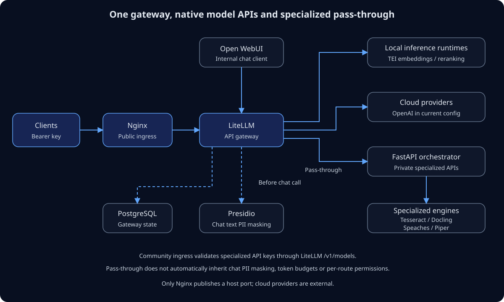

# AIFactoryBox

One API gateway for model calls and specialized AI services. LiteLLM provides
the model interfaces and native pass-through; FastAPI retains the adapters and
local OCR functionality that the model gateway does not supply.

[Open diagram at full size](assets/gateway-architecture.svg).

## Reading guide

1. [Architecture](architecture.md): understand the request paths and boundaries.
2. [Quickstart](quickstart.md): configure and start the existing stack.
3. [APIs](apis.md): call model and specialized endpoints with a bearer key.
4. [Security](security.md): understand PII masking and Community authentication limits.
5. [Models](models.md): inspect the actual defaults and their tradeoffs.
6. [Development](development.md): run checks and distinguish test evidence from full-stack readiness.

The current implementation targets a Docker Compose deployment. A minimal
LiteLLM + Ollama installation, hardware profiles, model catalog and management
console are design directions, not available features.
