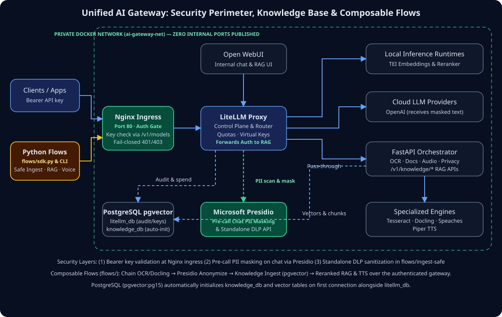

# AIFactoryBox

One API gateway for model calls, specialized AI services and Knowledge Base RAG.
LiteLLM provides the model interfaces and native pass-through; FastAPI retains
the document, audio, privacy, local OCR and `pgvector` Knowledge Base adapters.

[Open diagram at full size](assets/gateway-architecture.svg).

## Reading guide

1. [Architecture](architecture.md): understand the request paths and boundaries.
2. [Quickstart](quickstart.md): configure and start the existing stack.
3. [APIs](apis.md): call model, specialized and `/v1/knowledge/*` endpoints with a bearer key.
4. [Composable Python Flows](flows.md): orchestrate multi-step ingestion, RAG and voice workflows via `flows/`.
5. [Security](security.md): understand PII masking, header forwarding and Community authentication limits.
6. [Models](models.md): inspect the actual defaults and their tradeoffs.
7. [Development](development.md): run checks and distinguish test evidence from full-stack readiness.

The full gateway targets Docker Compose. The separate [minimal variant](minimal.md)
provides LiteLLM in Python or Docker with Ollama/Gemma, without a database.
Real-model validation of that variant remains pending. Hardware profiles, a model
catalog and management console remain design directions.
